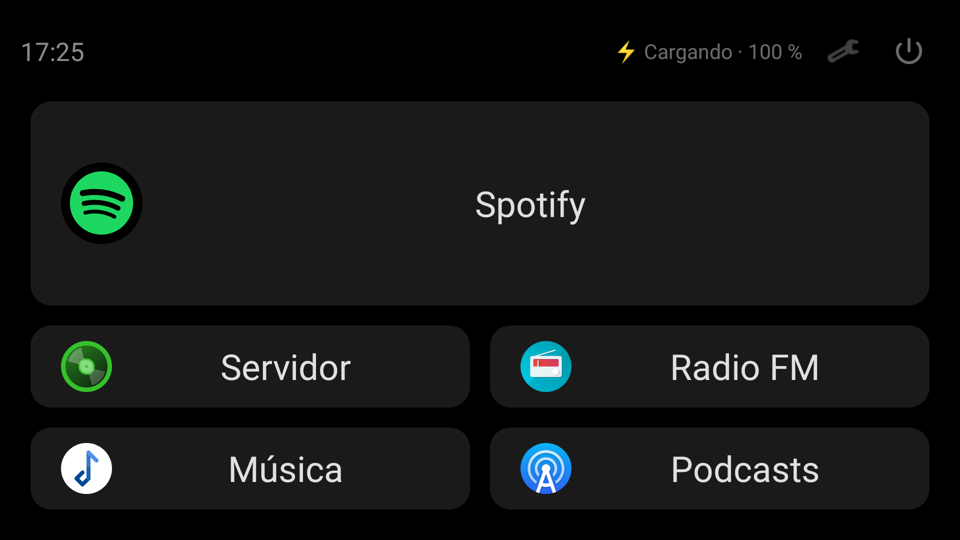
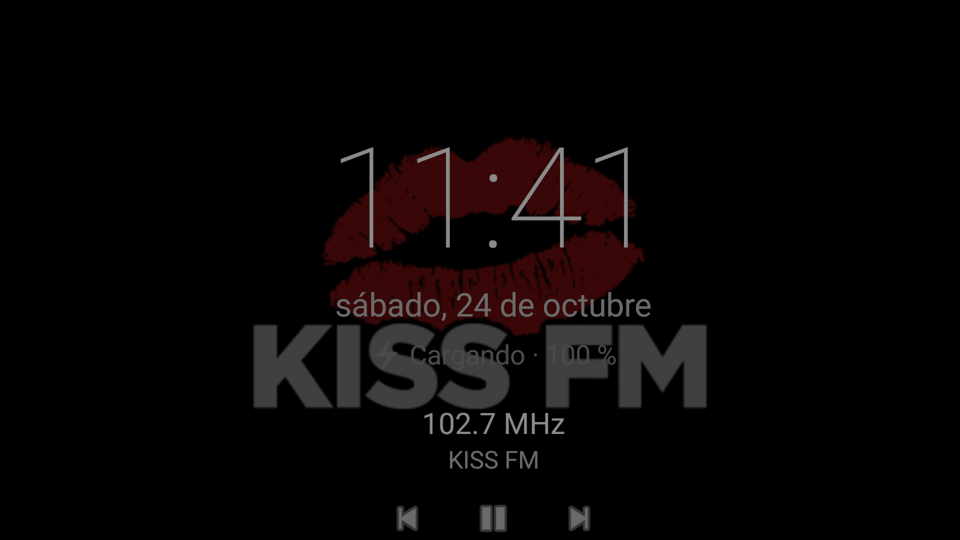
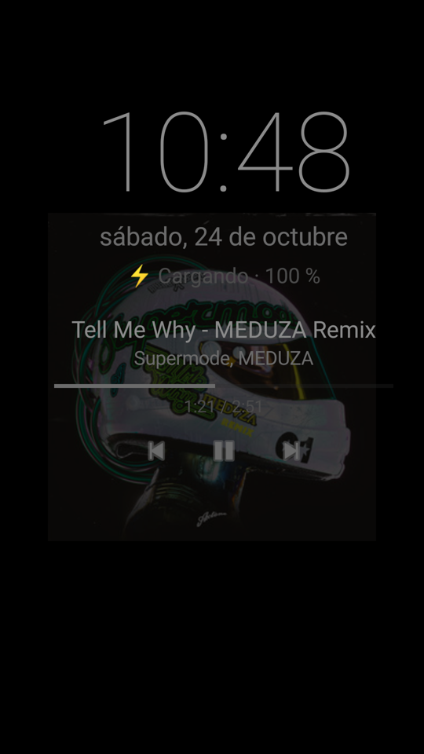
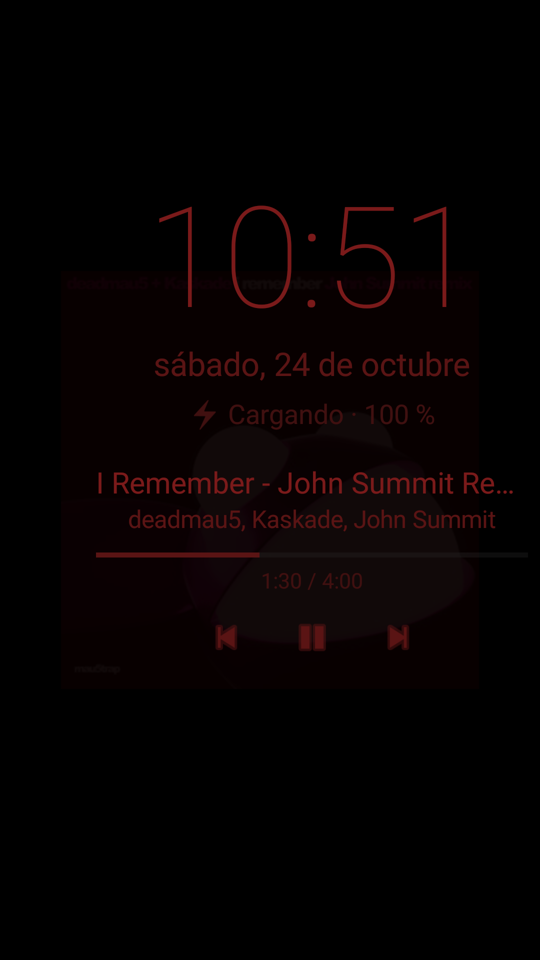
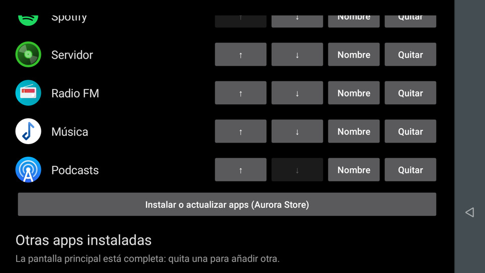
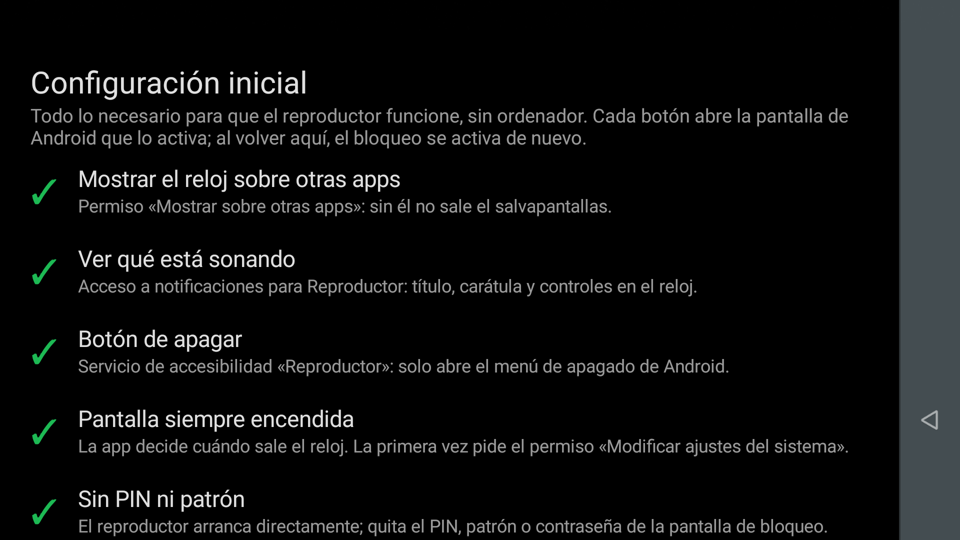
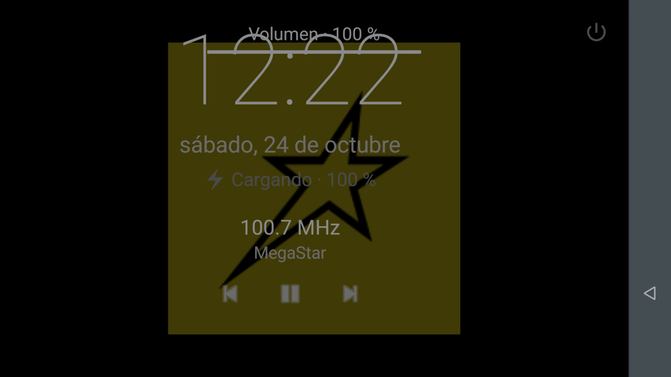
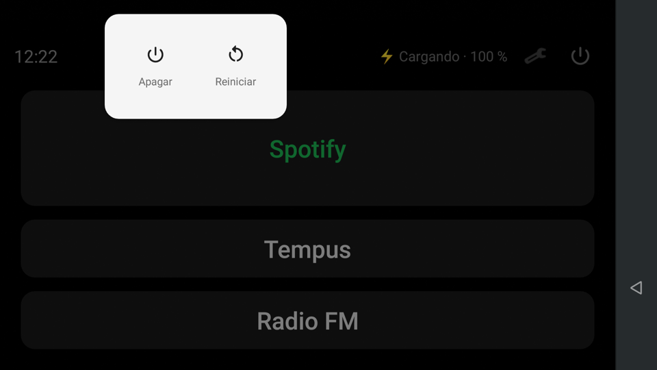
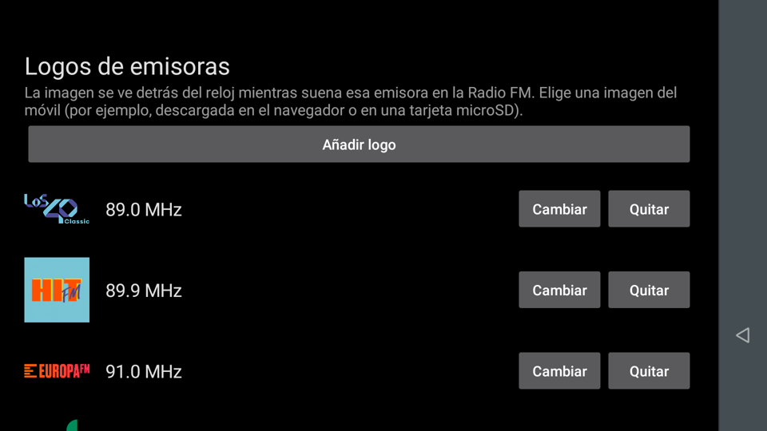

# DeskMusicPlayer

*[Read in English](README.en.md)*

Un móvil antiguo convertido en un **reproductor de música fijo en el escritorio**: arranca bloqueado en una pantalla con
las apps de música que se elijan (Spotify, un servidor de música en casa, la Radio FM, MP3, podcasts…) y, cuando nadie lo
toca, muestra un reloj con lo que está sonando.


| Pantalla principal | Reloj con la Radio FM |
|---|---|
|  |  |

| Qué está sonando | Modo noche |
|---|---|
|  |  |

## El problema

Tenía un Motorola Moto G5 Plus en un cajón que ya no servía para el día a día: se quedó en Android 8.1, lleva sin
actualizaciones de seguridad desde febrero de 2019 y su batería está gastada por los años y el uso. Como teléfono
personal no era ni práctico ni seguro, pero enchufado en el escritorio, sin cuentas y usado solo para música, ninguna de
esas cosas pesa.

Por eso el proyecto está pensado **para móviles antiguos**: **no se inicia sesión en ninguna cuenta de Google ni se usa
Google Play** (un móvil sin parches no debería guardar cuentas personales) y las apps vienen de F-Droid o de Aurora Store
en modo anónimo. En un móvil moderno, con actualizaciones y sus propias tiendas, nada de esto tiene sentido.

La primera versión usaba FreeKiosk, una app de kiosco de código abierto. Tenía fallos en Android 8.1 que llegaban a dejar
el móvil sin bloqueo al arrancar, y cambiar el reloj obligaba a escribir una página HTML entera por `adb`. Así que lo
sustituí por una app propia.

## Qué hace

App Android nativa en Kotlin que actúa como pantalla de inicio y, como **device owner**, bloquea el móvil a las apps
elegidas, sin root y sin modificar el sistema.

- **Pantalla principal configurable:** hasta 5 apps, una grande arriba y el resto en cuadrícula, con su icono y el nombre
  que se quiera («Servidor» en lugar de «Tempus»). Se ordenan con ↑ ↓. Solo se pueden abrir esas apps; Atrás e Inicio
  siempre vuelven a la pantalla principal.
- **Reloj como salvapantallas:** tras un tiempo sin tocar la pantalla, también dentro de otras apps y con batería,
  aparece un reloj con la fecha y la batería, que se desplaza un poco cada minuto.
- **Qué está sonando:** título, artista, carátula y progreso de la app activa, con anterior / pausa / siguiente. Con la
  radio muestra la frecuencia, el nombre RDS y el logo de la emisora.
- **Gestos como en un reproductor de vídeo:** deslizar en la mitad izquierda cambia el brillo y en la derecha el volumen.
- **Instalar, actualizar y desinstalar apps** sin salir del bloqueo, con la tienda que se elija (Aurora Store, F-Droid o
  Droid-ify; Google Play no se ofrece). Si no hay ninguna, la app lleva a la página oficial de Aurora Store.
- **Configuración inicial sin ordenador:** una pantalla con cada permiso o ajuste necesario, su estado (✓) y un botón que
  abre la pantalla de Android que lo activa.
- **Logos de emisoras desde el móvil**, elegidos con el selector de imágenes de Android.
- **Modo noche** en rojo tenue dentro de un horario y **menú de apagado** con un icono.

| Apps de la pantalla principal | Configuración inicial |
|---|---|
|  |  |

| Volumen al deslizar | Menú de apagado |
|---|---|
|  |  |

| Logos de emisoras |
|---|
|  |

## Ingeniería destacada

- **Salvapantallas que funciona con batería:** el `DreamService` de Android solo funciona cargando en este móvil
  (`config_dreamsEnabledOnBatteryConfig=false`) y una app no ve los toques en otras apps. Una ventana superpuesta de 1×1
  con `FLAG_WATCH_OUTSIDE_TOUCH` recibe un aviso de cada toque (sin coordenadas) y reinicia el contador; el reloj es otra
  ventana superpuesta, así que al cerrarla reaparece la app que había debajo.
- **Mantenimiento sin soltar el bloqueo:** para abrir una pantalla de Android (un permiso, el navegador, el selector de
  imágenes) la primera versión soltaba el *lock task*, y en Android 8.1 eso dejaba el móvil en una pantalla negra. Ahora
  la app nunca suelta el bloqueo: añade solo la app necesaria a la lista permitida y la retira en cuanto vuelve a
  mostrarse cualquiera de sus pantallas.
- **Instalar con el bloqueo puesto:** el *lock task* bloqueaba también la confirmación de instalación de Android, así que
  no se podía instalar nada. La app averigua en el propio móvil qué paquete muestra esa confirmación (cambia según el
  fabricante) y lo permite siempre, junto con la tienda elegida. Como device owner, desinstala sin diálogos del sistema.
- **El bloqueo sobrevive a las actualizaciones:** instalar una versión nueva corta el *lock task*; un receptor de
  `MY_PACKAGE_REPLACED` reabre la pantalla principal, que vuelve a bloquearse.
- **Logos de radio sin API:** la radio de fábrica solo publica la frecuencia y el nombre RDS, así que el logo se busca por
  frecuencia (`93.9.png`) en la carpeta de la app; la frecuencia se acepta con coma o punto y se normaliza.
- **Respeta el límite de volumen seguro:** por encima del nivel recomendado para auriculares Android limita
  `setStreamVolume` sin avisar; la app muestra el nivel real y, al soltar el dedo, el aviso del propio sistema.
- **Apagar sin permisos de sistema:** ninguna app puede apagar el móvil, ni siendo device owner; un servicio de
  accesibilidad mínimo solo abre el menú de apagado de Android.
- **Lógica separada de Android:** la selección de apps (orden, límite, guardado), las tiendas, las reglas de qué se puede
  desinstalar, el formato del reloj, el horario nocturno, los gestos y las frecuencias son clases puras con 54 tests JUnit.

## Cómo lo desarrollé: agentes de IA con método

Igual que en [MyCarDisplay](https://github.com/santi-cast/mycardisplay), lo construí con agentes de IA sobre **Pi** +
[**Gentle Shell**](https://github.com/Gentleman-Programming/gentle-shell) y
[**Gentle AI**](https://github.com/Gentleman-Programming/gentle-ai). Los agentes ejecutan; yo decido el alcance, apruebo
cada paso y lo pruebo en el móvil real.

| Práctica | Qué significó en este proyecto |
|---|---|
| **Organic Driven Development (ODD)** | Un documento con las especificaciones y las tareas por cada función, y commits pequeños, cada uno con sus tests y su documentación. |
| **Test-first** | Cada regla de lógica empezó con un test que fallaba (RED) antes de implementarla. |
| **Receipt-Driven Development (RDD)** | Los dos cambios de más riesgo (device owner y bloqueo) pasaron una revisión independiente, aprobada. |
| **Prueba en el dispositivo** | Cada función se comprobó en el móvil por `adb`: estado del bloqueo, capturas, sesiones multimedia y registros. Así salieron fallos que los tests no veían, como la pantalla negra al soltar el bloqueo. |
| **Memoria persistente** | [Engram](https://github.com/Gentleman-Programming/engram) conserva decisiones y contexto entre sesiones. |

## Probarlo

Requisitos: un móvil Android 8.x y, para el modo kiosco, **sin cuentas**.

**Desde el móvil**, sin ordenador: descargar el APK de la [página de releases](https://github.com/santi-cast/deskmusicplayer/releases),
elegir la app como pantalla de inicio y completar **🔧 → Configuración inicial**. El **modo kiosco** se activa tras
restablecer de fábrica escaneando el [código QR de la guía](docs/setup.md#modo-kiosco-con-un-código-qr-sin-ordenador)
(aún no probado en un móvil real) o con un ordenador. Para compilarlo hace falta JDK 17+ y el SDK de Android:

```bash
./gradlew assembleDebug testDebugUnitTest
adb install -r app/build/outputs/apk/debug/app-debug.apk
adb shell dpm set-device-owner com.reproductor.kiosk/.AdminReceiver
```

Los dos caminos, los ajustes recomendados y cómo deshacer el modo kiosco están en la [guía de instalación](docs/setup.md).

## Limitaciones conocidas

- La detección de toques del salvapantallas depende de un comportamiento de Android 8.x que las versiones nuevas
  restringen; en Android 12 o superior habría que buscar otra vía.
- El código QR para activar el modo kiosco sin ordenador está generado y verificado (enlace y firma), pero **todavía no se
  ha probado restableciendo un móvil real**; con ordenador (`adb`) sí está probado.
- La Radio FM es opcional: muchos móviles no tienen sintonizador. El nombre de la emisora, los logos y el recorrido de
  favoritas están hechos para la app de radio de Motorola.
- Google Play no se ofrece como tienda, a propósito: el proyecto está pensado para un móvil sin cuenta de Google.
- No incluye logos de emisoras: pertenecen a sus dueños y cada uno añade los suyos.
- No se ha medido la duración de la batería desenchufado; está pensado para ir siempre enchufado.

## Documentación

| Documento | Contenido |
|---|---|
| [`docs/setup.md`](docs/setup.md) | Instalación desde el móvil o con ordenador, modo kiosco, tiendas y logos de las emisoras |
| [`docs/history.md`](docs/history.md) | Historia del proyecto: del Galaxy S3 a la app propia |

## Estructura del repositorio

```text
deskmusicplayer/
├── app/src/main/java/com/reproductor/kiosk/
│   ├── MainActivity.kt         # pantalla principal (launcher) generada desde la selección
│   ├── AppSelection.kt         # apps elegidas: orden, nombres, límite y lista del bloqueo
│   ├── AppsActivity.kt         # ajustes de apps: añadir, ordenar, renombrar, tienda, desinstalar
│   ├── Stores.kt               # tiendas admitidas (sin Google Play)
│   ├── Uninstaller.kt          # desinstalación como device owner
│   ├── SetupActivity.kt        # configuración inicial sin ordenador
│   ├── Kiosk.kt                # políticas de device owner, bloqueo y permisos temporales
│   ├── ScreensaverService.kt   # inactividad con la ventana que vigila los toques
│   ├── ClockOverlay.kt         # reloj, qué está sonando, gestos, modo noche
│   ├── NowPlaying.kt           # sesión multimedia activa
│   ├── StationLogos.kt         # logos de FM por frecuencia
│   ├── LogosActivity.kt        # logos de emisoras desde el móvil
│   ├── PowerMenuService.kt     # menú de apagado del sistema
│   └── SettingsActivity.kt     # ajustes
├── app/src/test/               # tests JUnit
└── docs/                       # instalación, historia y capturas
```

## Origen del proyecto

Empezó como un montaje con apps existentes para aprovechar un móvil viejo y acabó en una app propia cuando esas apps se
quedaron cortas; después creció para poder montarse en cualquier móvil antiguo sin ordenador. La
[historia completa](docs/history.md) recoge cada decisión: por qué este móvil y no el Galaxy S3, por qué sin LineageOS,
la limpieza de apps, los problemas de FreeKiosk y lo que se fue añadiendo.

## Licencia

Este proyecto se distribuye bajo licencia MIT. Ver [LICENSE](./LICENSE) para el texto completo. Spotify, Tempus, Aurora
Store y los nombres de las emisoras pertenecen a sus dueños.

## Autor

**Santiago Castillo** · Desarrollo de Aplicaciones Multiplataforma · Madrid
[GitHub](https://github.com/santi-cast)
