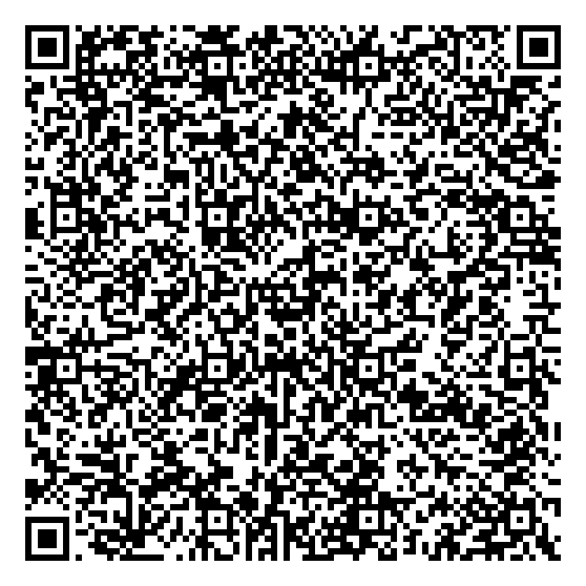

# Instalación

*[Read in English](setup.en.md)*

## Antes de empezar: para qué móvil es

DeskMusicPlayer está pensado para **reaprovechar un móvil antiguo** que ya no sirve como teléfono (sin actualizaciones
de seguridad, batería gastada). Por eso:

- **No inicie sesión en ninguna cuenta de Google** y no use Google Play: un móvil sin parches no debería guardar cuentas
  personales. Las apps se instalan desde **F-Droid** o desde **Aurora Store** en modo anónimo.
- El móvil queda dedicado a la música y, con el modo kiosco, bloqueado en las apps elegidas.
- En un móvil moderno no tiene sentido montarlo así.

Probado en un Motorola Moto G5 Plus (XT1685) con Android 8.1 de fábrica. La app necesita Android 8.0 o superior; la
detección de toques del salvapantallas se basa en un comportamiento que las versiones nuevas de Android (12 o más)
restringen.

**Radio FM opcional:** muchos móviles no tienen sintonizador, y si falta simplemente no aparece. El nombre de la emisora,
los logos y el recorrido de favoritas están hechos para la app de radio de Motorola; otras apps de radio funcionan como
cualquier reproductor si publican lo que suena.

## Opción A: todo desde el móvil

1. **Instale la app**: con el navegador del móvil, descargue el APK de la última versión en
   https://github.com/santi-cast/deskmusicplayer/releases y ábralo. Android pedirá permitir instalar apps desde
   el navegador.
2. **Elíjala como pantalla de inicio**: al pulsar Inicio, Android pregunta qué app usar; elija *Reproductor* y *Siempre*.
3. **🔧 → Configuración inicial**: complete los pasos marcados con •. Cada *Abrir* lleva a la pantalla de Android
   correspondiente; al volver, el paso aparece con ✓:
   - *Mostrar el reloj sobre otras apps* (sin él no sale el salvapantallas).
   - *Ver qué está sonando* (acceso a notificaciones).
   - *Botón de apagar* (servicio de accesibilidad que solo abre el menú de apagado).
   - *Pantalla siempre encendida* (la primera vez pide el permiso «Modificar ajustes del sistema»).
   - *Sin PIN ni patrón* en la pantalla de bloqueo, para que el reproductor arranque directamente.
   - *Sin pantalla de bloqueo* (solo con el modo kiosco). Android no deja comprobarlo desde una app, así que su ✓
     aparece tras pulsar *Aplicar*.

   Mientras falte algo imprescindible, la pantalla principal muestra un aviso naranja que lleva aquí.
4. **🔧 → Apps de la pantalla principal**: elija hasta 5 apps, ordénelas (la primera es la grande) y póngales nombre. Si
   no hay ninguna tienda instalada, **Instalar Aurora Store** abre su página oficial de F-Droid: pulse *Descargar APK*,
   ábralo y, si Android lo pide, permita instalar apps desde el navegador.
5. **🔧 → Logos de emisoras** (opcional, solo con la radio de Motorola): elija una imagen del móvil para cada emisora.

Sin el modo kiosco, la app funciona igual como pantalla de inicio y reproductor, pero no bloquea: se puede salir desde la
barra de notificaciones.

### Modo kiosco con un código QR, sin ordenador

Es el método de Android para preparar móviles de empresa. **No está probado todavía en un móvil real**: si lo prueba,
cuéntelo en una *issue*.

1. **Restablezca el móvil de fábrica** (borra todo; el modo kiosco solo se activa en un móvil sin cuentas).
2. En la **pantalla de bienvenida**, toque **6 veces seguidas** en el mismo sitio. Se abre un lector de QR; en Android 7 y
   8 el asistente puede pedir antes conectarse a una Wi-Fi para descargarlo.
3. Escanee este código:

   

4. Android descarga la última versión de las [releases](https://github.com/santi-cast/deskmusicplayer/releases),
   comprueba que está firmada con la clave del proyecto, la instala como *device owner* y termina la configuración. La
   app se abre bloqueada; después, complete **🔧 → Configuración inicial**.

El QR ([`provisioning.json`](provisioning.json)) contiene el componente de administración, el enlace fijo a la última
versión (`releases/latest/download/deskmusicplayer.apk`), la huella SHA-256 del certificado de firma y la opción de no
desactivar las apps del sistema (la radio, el navegador). Sirve para todas las versiones firmadas con la misma clave. Se
genera con `tools/provisioning_qr.py`.

## Opción B: con ordenador

**Requisitos:** depuración USB activada y el PC autorizado para `adb`; en el PC, JDK 17 o superior y el SDK de Android
(plataforma 36), con su ruta en `local.properties`: `sdk.dir=/ruta/a/Android/Sdk`.

```
./gradlew assembleDebug testDebugUnitTest
adb install -r app/build/outputs/apk/debug/app-debug.apk
```

`assembleDebug` firma con la clave de depuración de su ordenador. Para una versión *release* firmada, `assembleRelease`
lee la clave de un archivo de propiedades (`storeFile`, `storePassword`, `keyAlias`, `keyPassword`) indicado en la variable
`DESKMUSICPLAYER_SIGNING`; sin él, el APK sale sin firmar. Android no deja instalar una versión firmada con otra clave
encima de la que hay: habría que desinstalar, y eso quita el modo kiosco.

### Modo kiosco (device owner)

Bloquea el móvil a las apps elegidas. Android solo permite activarlo en un móvil **sin cuentas** (Ajustes → Cuentas); lo
más fácil es uno recién restablecido.

```
adb shell dpm set-device-owner com.reproductor.kiosk/.AdminReceiver
adb shell am start -n com.reproductor.kiosk/.MainActivity
```

Desde ese momento el móvil arranca en la app y solo se pueden abrir las apps elegidas, la tienda elegida y la confirmación
de instalación de Android. Para deshacerlo, entre en 🔧 y use **Quitar device owner**: el móvil vuelve a ser un teléfono
normal.

### Permisos y ajustes por `adb` (alternativa a la configuración inicial)

```
# Ventanas superpuestas: detector de toques y reloj
adb shell appops set com.reproductor.kiosk SYSTEM_ALERT_WINDOW allow
# Leer la sesión multimedia de la app que está sonando
adb shell cmd notification allow_listener com.reproductor.kiosk/com.reproductor.kiosk.MediaListener
# Servicio de accesibilidad que solo abre el menú de apagado
adb shell settings put secure enabled_accessibility_services com.reproductor.kiosk/com.reproductor.kiosk.PowerMenuService
adb shell settings put secure accessibility_enabled 1
# Sin pantalla de bloqueo, pantalla siempre encendida y rotación automática
adb shell locksettings set-disabled true
adb shell settings put system screen_off_timeout 2147483647
adb shell settings put system accelerometer_rotation 1
```

La orden de accesibilidad sustituye cualquier otro servicio de accesibilidad activo; si usa alguno, consulte antes
`adb shell settings get secure enabled_accessibility_services`.

## Apps y tiendas

- **Apps de la pantalla principal:** si nunca se han configurado, se muestran las apps por defecto que estén instaladas
  (Spotify, Tempus como «Servidor», la Radio FM de Motorola, Auxio como «Música» y AntennaPod como «Podcasts»). Los
  nombres de paquete por defecto están en `app/src/main/java/com/reproductor/kiosk/Apps.kt`.
- **Tiendas admitidas:** Aurora Store, F-Droid y Droid-ify. Si hay varias, se elige en *Apps de la pantalla principal*.
  Google Play no se ofrece, a propósito.
- **Desinstalar:** desde la misma pantalla, para las apps que no están en la pantalla principal. No se pueden desinstalar
  las apps que traía el móvil, las tiendas ni la propia app.
- **Música local:** Auxio necesita elegir la carpeta de música una vez en *Fuentes de música*, y ese selector no abre con
  el bloqueo: en 🔧 desactive *Bloqueo activado*, elija la carpeta (memoria interna o microSD) y vuelva a activarlo.

## Logos de las emisoras de FM

La radio no publica imágenes. Lo más cómodo es **🔧 → Logos de emisoras**: *Añadir logo* pide la frecuencia (viene
rellena con la emisora que suena; acepta «93,9» o «93.9») y abre el selector de imágenes de Android. La imagen se guarda
reducida a 512 px.

Desde un ordenador también se pueden copiar directamente, con la frecuencia como nombre (`93.9.png`; también sirven
`.jpg`, `.jpeg` y `.webp`):

```
adb push 93.9.png /sdcard/Android/data/com.reproductor.kiosk/files/emisoras/
```

Este repositorio no incluye logos: pertenecen a las emisoras.

Para que anterior/siguiente recorran solo sus emisoras favoritas (en la radio de Motorola), active el botón de
*búsqueda de favoritos* en la notificación de la radio (con el bloqueo desactivado, porque la barra de notificaciones
está bloqueada).

## Órdenes útiles

```
# Mostrar el reloj ahora
adb shell am start-foreground-service -n com.reproductor.kiosk/.ScreensaverService -a com.reproductor.kiosk.SHOW_CLOCK
# Captura de pantalla
adb exec-out screencap -p > captura.png
```
